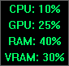

# MiniMonitor


Minimalist Windows desktop widget for real-time CPU and GPU utilization monitoring.



## General Info on this project:
This was created by an engineer who works on CAD all day and never made a full program by himself.
I am learning to program step by step with the help of local LLM helpers, so please don't judge me for the result. i know it will never be perfect, but every release will be 100% tested and proven working.
I don't let the model write all the code for me, because i really want to learn something with this project, but i also won't turn down good suggestions and answers.
ALSO i am very open for ideas on improvements and new features.

## 🚀 Features
- **Minimalist Design**: Small window that stays out of your way.
- **Low Overhead**: Uses Windows Performance Data Helper (PDH) API for efficient, low-resource monitoring.
- **Real-time Updates**: Refreshes every 500ms.
- **Non-Intrusive**: Uses `WS_EX_TOOLWINDOW` so it does not appear in the taskbar.
- **Lightweight**: Minimal dependencies; single executable expected for typical builds.

## 🖥️ Display Format
The widget displays current utilization in a stacked format:
```text
CPU:XX%
GPU:XX%
RAM:XX%
VRAM:XX%
```

## 🖱️ Controls
| Action | Result |
| :--- | :--- |
| **SHIFT + Left Click & Drag** | Move the widget around your screen |
| **Double Click** | Close the widget |
| **Right Click** | Open Info/Settings window |

## 🛠️ Technical Details
- **Language**: C++
- **API**: Win32 API, PDH (Performance Data Helper)
- **Dependencies**: `pdh.lib` (linked via `#pragma comment`)
- **Build type**: Recommended Release x64 for lowest overhead
- **Window style**: borderless / toolwindow; designed for minimal screen real estate

## 🔨 Build Instructions
### Prerequisites
- **OS**: Windows 10/11
- **IDE**: Microsoft Visual Studio (with "Desktop development with C++" workload installed).

### Steps
1. Open the solution (`MiniMonitor.slnx` or `.vcxproj`) in Visual Studio.
2. Set the build configuration to **Release**.
3. Set the platform to **x64**.
4. Build the solution (**Ctrl+Shift+B**).
5. Run the generated `.exe` from the output folder (e.g., `x64/Release/`).

## 🗒️ Version History
See [VERSION_HISTORY.md](./docs/VERSION_HISTORY.md) for the full changelog.

## 🗒️ Planned features and improvements.
- Adding a tooltip that says "Right click for settings" when the user hovers the mouse over the main window. Note: haven't figured out how yet.
- I will make a really really cool logo in SolidWorks someday :)
- Add an option to change the border of the main window to a different color.
- Idea for faster refresh and a speed option, but I have to test how the code behaves if i go too far. The goal would be maybe a save 15Hz.

## Known Bugs and Issues.
- Saving the changes does not affect the settings/info window until you reopen it.
- The main loop reads the config file every tick. Which is just a sloppy solution. Can be done better.

## 📜 License
Copyright © 2026 Patrick Christe

This work is licensed under the Creative Commons Attribution-NonCommercial 4.0 International License (CC BY-NC 4.0).

Summary of Rights:
You are free to:

Share: Copy and redistribute the material in any medium or format.
Adapt: Remix, transform, and build upon the material.

Under the following terms:
Attribution: You must give appropriate credit, provide a link to the license, and indicate if changes were made. 
You may do so in any reasonable manner, but not in any way that suggests the licensor endorses you or your use.
NonCommercial: You may not use the material for commercial purposes.

Additional Notes:
Not applicable when permitted under the Copyright and Related Rights Exceptions of a country where the work is located, 
provided such exceptions are consistent with the tripartite convention on intellectual property.

To view a copy of this license, visit:
https://creativecommons.org/licenses/by-nc/4.0/legalcode
